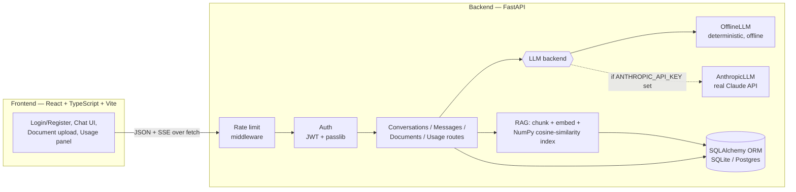

# AI Chat Platform

A small but complete AI assistant chat SaaS: real auth, a real persisted
backend, a real streaming chat UI, and real (if lightweight) retrieval-
augmented grounding — frontend and backend actually wired together and
exercised end-to-end, not two demos glued together for a screenshot.

## Why this project exists

Most of my other portfolio repos are single-purpose backend services or
agents — a RAG pipeline here, an eval harness there. This one is different
on purpose: it's a **full-stack product slice**. The goal was to build the
kind of thing a small AI SaaS actually ships — auth, persistence, a
streaming chat experience, document-grounded answers, rate limiting, and
usage metering — end to end, with a frontend that looks like a real product
rather than a Bootstrap default.

Everything in this repo runs and is tested **with zero network calls and
zero API keys** via a deterministic offline AI backend, but it is built so
that pointing it at a real `ANTHROPIC_API_KEY` is a one-line config change,
not a rewrite.

## Architecture

```
  +-----------------------+        HTTPS fetch: JSON + SSE        +-----------------------------+
  |   FRONTEND (React)    |  ------------------------------->     |      BACKEND (FastAPI)       |
  |   Vite + TypeScript   |  <-------------------------------     |                               |
  |                       |     streamed text/event-stream        |  JWT auth -> rate limit ->    |
  |  - Login / Register   |                                       |  conversation/message routes |
  |  - Conversation       |                                       |                               |
  |    sidebar             |                                      |             |                 |
  |  - Streaming message  |                                       |             v                 |
  |    thread (markdown)  |                                       |     +-----------------+       |
  |  - Document upload    |                                       |     |  LLM backend    |       |
  |  - Usage panel         |                                      |     |  (pluggable)    |       |
  +-----------------------+                                       |     +--------+--------+       |
                                                                   |              |                |
                                                        +----------+--------------+-----------+    |
                                                        |                                      |    |
                                                 +------v------+                       +-------v------+
                                                 | OfflineLLM  |                       | AnthropicLLM |
                                                 | (default,   |                       | (if API key |
                                                 |  no network)|                       |  is set)    |
                                                 +-------------+                       +-------------+
                                                                   |                               |
                                                                   |             |                 |
                                                                   |             v                 |
                                                                   |   +-----------------------+   |
                                                                   |   |  Lightweight RAG      |   |
                                                                   |   |  chunk -> embed ->    |   |
                                                                   |   |  NumPy cosine index   |   |
                                                                   |   |  (per conversation)   |   |
                                                                   |   +----------+------------+   |
                                                                   |              |                |
                                                                   |   +----------v------------+   |
                                                                   |   |  SQLAlchemy ORM       |   |
                                                                   |   |  User/Conversation/   |   |
                                                                   |   |  Message/DocumentChunk|   |
                                                                   |   +----------+------------+   |
                                                                   +--------------+----------------+
                                                                                  |
                                                                       +----------v----------+
                                                                       |  SQLite (default) /  |
                                                                       |  Postgres (drop-in)  |
                                                                       +-----------------------+
```



## Features

**Backend (`backend/`, Python + FastAPI)**

- Register / login with `passlib`-hashed passwords and JWT access tokens; all conversation/message/document/usage routes require a valid bearer token.
- SQLAlchemy models (`User`, `Conversation`, `Message`, `DocumentChunk`) on SQLite by default — swapping to Postgres is a one-line `DATABASE_URL` change, no SQLite-specific syntax anywhere.
- Conversations: create, list (own conversations only), fetch message history.
- Chat: `POST /conversations/{id}/messages` persists the user's message, retrieves relevant document chunks, calls the configured AI backend, **streams** the answer back over Server-Sent Events, and persists the full assistant reply once streaming completes.
- Pluggable AI backend: `OfflineLLM` (deterministic, zero network, used whenever `ANTHROPIC_API_KEY` is unset) and `AnthropicLLM` (the real Claude API via the official `anthropic` SDK, streamed with `client.messages.stream`).
- Lightweight RAG grounding: `POST /conversations/{id}/documents` chunks an uploaded text file, embeds each chunk, and stores the vectors; later messages in that conversation retrieve the most relevant chunks via a plain NumPy cosine-similarity search (no external vector database) and feed them to the AI backend as grounding context.
- Rate limiting: in-memory per-user token-bucket ASGI middleware on the message-sending endpoint, returns `429` once a user exceeds N messages/minute.
- Usage metering: `GET /usage` returns a user's message count and an estimated-token count — SaaS-style metering without real billing.
- 50 pytest tests covering auth, ownership isolation, the full offline chat + RAG flow, rate limiting, usage, and the real `AnthropicLLM` prompt construction (via an injected fake client) — all offline, zero secrets.

**Frontend (`frontend/`, React + TypeScript + Vite)**

- Login / Register forms with client-side validation, wired to the real backend.
- A chat interface: a dark conversation sidebar (create/select conversations, usage stats, logout), a message thread rendering user/AI messages with AI markdown rendered to real HTML (lists, code blocks, bold, links), a message input box, and **live streaming rendering** of the AI's answer as SSE chunks arrive.
- A document-upload control per conversation, wired to the RAG endpoint, showing indexed documents and chunk counts.
- A usage panel (message count + estimated tokens) pulling from `/usage`.
- Deliberate, non-generic visual design (see [UI](#what-the-ui-looks-like) below) with explicit loading / empty / error states for every view.
- 23 Vitest + React Testing Library tests covering SSE parsing (including chunk-boundary reassembly), the streaming message component, message list rendering (including markdown), and login form validation/success/error — all against mocked `fetch`, zero real backend needed.

## Project structure

```
ai-chat-platform/
├── backend/
│   ├── app/
│   │   ├── main.py              # FastAPI app, middleware wiring, lifespan
│   │   ├── config.py             # pydantic-settings, env-driven config
│   │   ├── database.py           # SQLAlchemy engine/session (SQLite/Postgres)
│   │   ├── models.py             # User, Conversation, Message, DocumentChunk
│   │   ├── schemas.py            # Pydantic request/response models
│   │   ├── security.py           # password hashing + JWT
│   │   ├── deps.py               # get_current_user dependency
│   │   ├── rate_limit.py         # token-bucket ASGI middleware
│   │   ├── usage.py              # usage metering helpers
│   │   ├── embeddings.py         # HashingEmbedder / SentenceTransformerEmbedder
│   │   ├── rag.py                # chunking + NumPy cosine-similarity retrieval
│   │   ├── llm/
│   │   │   ├── base.py           # LLMBackend interface
│   │   │   ├── offline_llm.py    # deterministic offline AI backend
│   │   │   ├── anthropic_llm.py  # real Claude backend (streamed)
│   │   │   └── factory.py        # picks a backend based on config
│   │   └── routers/              # auth, conversations, usage
│   ├── tests/                    # 50 pytest tests
│   ├── Dockerfile
│   └── pyproject.toml
├── frontend/
│   ├── src/
│   │   ├── api/                  # client.ts (REST), chatStream.ts (SSE)
│   │   ├── components/           # Sidebar, MessageList, StreamingMessage, ...
│   │   ├── context/AuthContext.tsx
│   │   ├── lib/                  # sse.ts, markdown.ts, validation.ts
│   │   ├── pages/                 # LoginPage, RegisterPage, ChatPage
│   │   └── styles/index.css
│   ├── tests/                    # 23 Vitest + RTL tests
│   ├── Dockerfile
│   ├── nginx.conf
│   └── package.json
├── docker-compose.yml
├── .github/workflows/ci.yml
├── LICENSE
└── README.md
```

## Running it

### Option A — Docker Compose (whole stack, one command)

```bash
docker compose up --build
```

This builds the backend image (FastAPI + Uvicorn, SQLite file persisted in a
named volume) and the frontend image (a production Vite build served by
nginx), and wires them together:

- Frontend: http://localhost:8080
- Backend API: http://localhost:8000 (docs at `/docs`)

To use the real Claude API instead of the offline backend, export
`ANTHROPIC_API_KEY` before running `docker compose up` — docker-compose
passes it through automatically. Leave it unset to keep everything fully
offline.

### Option B — manual local dev (hot reload on both sides)

**Backend:**

```bash
cd backend
python -m venv venv
./venv/Scripts/activate   # Windows; use `source venv/bin/activate` on macOS/Linux
pip install -e ".[dev]"
uvicorn app.main:app --reload --port 8000
```

**Frontend** (separate terminal):

```bash
cd frontend
npm install
npm run dev
```

The frontend reads its backend URL from `VITE_API_URL` (see
`frontend/vite.config.ts` / `import.meta.env`), defaulting to
`http://localhost:8000`. The dev server runs on `http://localhost:5173`,
which is already in the backend's default `CORS_ALLOW_ORIGINS`.

Both sides also take a `.env` file — see `backend/.env.example`.

## A real worked example

This is the **actual** captured request/response sequence from running the
backend locally (`uvicorn app.main:app`) and driving it with real HTTP
requests — register → login → create a conversation → upload a short
document → ask a question grounded in it → get a streamed answer — using
the zero-network `OfflineLLM` backend. Nothing below is fabricated; some
repeated/boilerplate response headers are trimmed for readability.

**1. Register**

```
POST /auth/register
{"email":"demo@example.com","password":"demoPassword123"}

HTTP/1.1 201 Created
{"id":1,"email":"demo@example.com","created_at":"2026-10-27T19:13:40.423905"}
```

**2. Login**

```
POST /auth/login
{"email":"demo@example.com","password":"demoPassword123"}

HTTP/1.1 200 OK
{"access_token":"eyJhbGciOiJIUzI1NiIs...U5l1u310DNqgVNwgqh-Kb4HVlalm0JffSLUlz_YUXwY","token_type":"bearer"}
```

**3. Create a conversation**

```
POST /conversations
Authorization: Bearer <token>
{"title":"Refund policy questions"}

HTTP/1.1 201 Created
{"id":1,"title":"Refund policy questions","created_at":"2026-10-27T19:13:59.620929"}
```

**4. Upload a short document** (`refund-policy.txt`, 5 sentences about refund terms)

```
POST /conversations/1/documents
Authorization: Bearer <token>
Content-Type: multipart/form-data; file=refund-policy.txt

HTTP/1.1 201 Created
{"document_name":"refund-policy.txt","chunk_count":1}
```

**5. Ask a question grounded in that document, and stream the answer**

```
POST /conversations/1/messages
Authorization: Bearer <token>
{"content":"How long do I have to request a refund, and what email do I use?"}

HTTP/1.1 200 OK
Content-Type: text/event-stream; charset=utf-8

data: {"chunk": "Based "}
data: {"chunk": "on "}
data: {"chunk": "the "}
data: {"chunk": "document(s) "}
...
data: {"chunk": "AI "}
data: {"chunk": "Chat "}
data: {"chunk": "Platform "}
data: {"chunk": "Refund "}
data: {"chunk": "Policy\n\n"}
data: {"chunk": "Customers "}
data: {"chunk": "can "}
data: {"chunk": "request "}
data: {"chunk": "a "}
data: {"chunk": "full "}
data: {"chunk": "refund "}
data: {"chunk": "within "}
data: {"chunk": "fourteen "}
data: {"chunk": "(14) "}
data: {"chunk": "days "}
data: {"chunk": "of "}
data: {"chunk": "purchase\n"}
data: {"chunk": "by "}
data: {"chunk": "emailing "}
data: {"chunk": "billing@example.com "}
...
event: done
data: {"message_id": 2}
```

The assembled answer (also what `GET /conversations/1/messages` returns as
the persisted assistant message) is:

> Based on the document(s) you shared in this conversation, here is what's
> relevant to your question:
>
> - AI Chat Platform Refund Policy
>
>   Customers can request a full refund within fourteen (14) days of purchase
>   by emailing billing@example.com with their order number. Refunds are
>   processed within five business days and are returned to the...
>
> **In short:** the attached document directly covers `refund`, `request`,
> which is what your question is about.

That's genuine retrieval-augmented grounding: the uploaded document was
chunked, embedded, retrieved by cosine similarity against the question, and
quoted back in the streamed answer — with no network call and no API key.

**6. Usage metering**

```
GET /usage
Authorization: Bearer <token>

HTTP/1.1 200 OK
{"message_count":1,"estimated_tokens":129}
```

**7. Ownership isolation** (a second user cannot read the first user's conversation)

```
GET /conversations/1/messages
Authorization: Bearer <intruder's token>

HTTP/1.1 404 Not Found
```

**8. CORS, confirmed against the real frontend dev origin** — with the Vite
dev server actually running on `http://localhost:5173` and the backend on
`http://localhost:8000`, a request carrying `Origin: http://localhost:5173`
gets back:

```
access-control-allow-credentials: true
access-control-allow-origin: http://localhost:5173
```

...confirming the two halves of the stack can actually talk to each other
across origins, not just in theory.

## What the UI looks like

- **Auth screens**: a centered card on a soft indigo-tinted radial
  background, with a small uppercase brand mark, a headline, inputs with a
  focus ring in the primary indigo (`#5b4bf0`), inline validation/error
  messages in a soft red banner, and a single primary button per form.
- **Chat screen**: a two-pane layout — a dark slate sidebar (conversation
  list with an active-state highlight, a usage panel showing message count
  and estimated tokens, and the signed-in user's email + logout button) next
  to a light main panel with a header (conversation title + "Attach
  document" control and chips showing indexed documents/chunk counts), a
  scrollable message thread (user bubbles in indigo aligned right, assistant
  bubbles in white with a border aligned left, AI markdown rendered to real
  HTML — lists, `code`, fenced code blocks on a dark background, bold text,
  links), and a bottom input bar with a textarea and a Send button.
- **Streaming**: while the AI is replying, a blinking caret-style cursor sits
  at the end of the growing assistant bubble; a "Thinking…" placeholder shows
  before the first chunk arrives.
- Every view (conversation list, message thread, document list) has an
  explicit loading state, an explicit empty state with guidance text, and an
  explicit error state — none of them just render blank.

## Testing

**Backend:**

```bash
cd backend
./venv/Scripts/python.exe -m ruff check .
./venv/Scripts/python.exe -m pytest -q
```

Result: `ruff check .` → all checks passed. `pytest -q` → **50 passed**, zero
network calls (an isolated SQLite file, the dependency-free `HashingEmbedder`,
and no Anthropic API key are forced in `tests/conftest.py`; `AnthropicLLM` is
exercised only via an injected fake client in `test_llm_anthropic.py`).

**Frontend:**

```bash
cd frontend
npm run lint
npm run typecheck
npm run build
npm test
```

Result: `eslint .` → 0 errors (1 pre-existing informational warning about a
context file exporting both a provider and a hook, a standard React pattern).
`tsc --noEmit` → clean. `vite build` → succeeds (`dist/` ~229 kB JS / 11 kB
CSS, gzipped ~75 kB / 2.6 kB). `vitest run` → **23 passed**, all against
mocked `fetch`/`ReadableStream`, zero real backend needed.

## Configuration reference

See `backend/.env.example` for the full list. The important ones:

| Variable | Default | Purpose |
|---|---|---|
| `DATABASE_URL` | `sqlite:///./ai_chat_platform.db` | Any SQLAlchemy URL; swap to Postgres with no code changes |
| `SECRET_KEY` | dev placeholder | JWT signing secret — change in any real deployment |
| `ANTHROPIC_API_KEY` | unset | Set to use the real Claude API instead of the offline backend |
| `ANTHROPIC_MODEL` | `claude-sonnet-5` | Model id passed to the Anthropic SDK |
| `EMBEDDINGS_BACKEND` | `auto` | `auto` \| `hashing` \| `sentence-transformers` (see below) |
| `RATE_LIMIT_MESSAGES_PER_MINUTE` | `20` | Per-user token-bucket capacity on the message endpoint |
| `CORS_ALLOW_ORIGINS` | `http://localhost:5173,...` | Comma-separated list of allowed frontend origins |

## Scope cuts (deliberate)

- **Embeddings default to a dependency-free hashing vectorizer, not a
  downloaded transformer model.** `sentence-transformers` is wired up as a
  real, optional backend (`app/embeddings.py`) and is used automatically if
  it's installed and a model loads successfully — but it isn't a hard
  dependency, because it pulls in PyTorch (hundreds of MB) and needs a
  network call to fetch model weights on first use. The hashing embedder is
  a legitimate bag-of-words cosine-similarity scheme (not a stub) and is
  what the test suite and the worked example above both exercise.
- **No client-side router.** The app has exactly two top-level screens
  (auth, chat), so a single piece of view state in `App.tsx` replaces
  `react-router` rather than adding a routing dependency for two screens.
- **No Alembic migrations.** Tables are created with
  `Base.metadata.create_all()` on startup, which is appropriate at this
  project's scale; a real production deployment behind Postgres would add
  migrations, but that's orthogonal to what this project demonstrates.
- **Rate limiting and usage metering are in-memory / single-process,** by
  design — the token-bucket state and usage counters would move to
  Redis/Postgres in a horizontally-scaled deployment, but the algorithm
  itself (and the tests for it) would be unchanged.

## License

MIT — see [LICENSE](LICENSE). Copyright (c) 2026 Samir Rafigzada.
